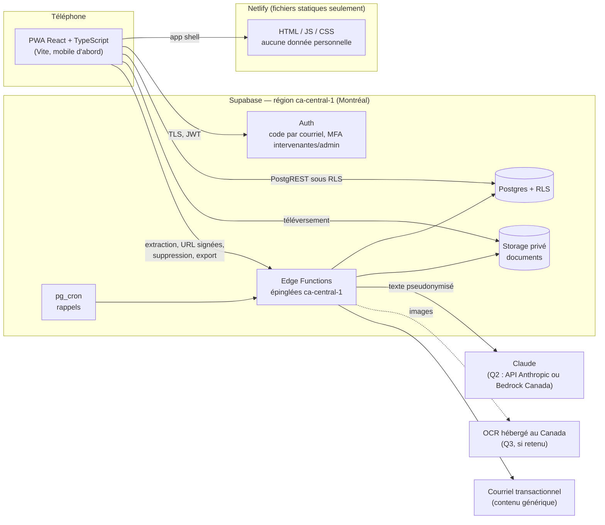
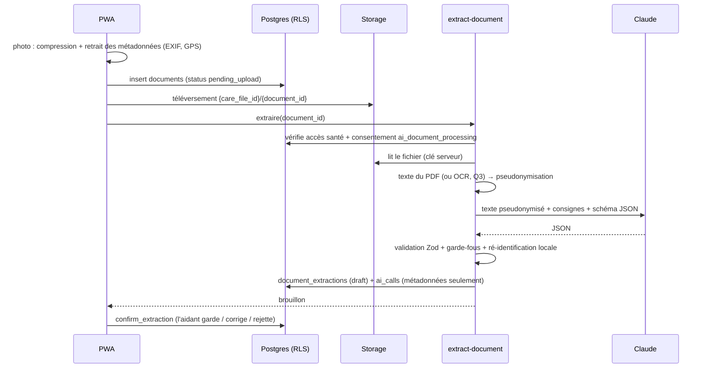

# Relais v0.1 — Architecture proposée

> Statut : **étapes 1 et 2 livrées** (socle, authentification, consentements ; dossier et membres). Les choix marqués _(Q1)_ à _(Q5)_
> suivent les hypothèses par défaut notées dans [`../PROGRESS.md`](../PROGRESS.md), en attendant les réponses.

## 1. Vue d'ensemble



- **Netlify ne sert que des fichiers statiques.** Aucune requête contenant des données du dossier n'y
  transite : le téléphone parle directement à Supabase, au Canada.
- **Tout le code serveur tourne dans des Edge Functions Supabase épinglées à `ca-central-1`**
  (option de région à l'appel, vérifiée en préproduction par l'en-tête de réponse). La clé de l'API
  Claude n'existe que là.
- **La base applique elle-même les permissions** (RLS) : même un client modifié ne peut pas lire au-delà
  de ce que son rôle autorise.

## 2. Pile technique

| Couche                    | Choix                                                                                   | Pourquoi                                                     |
| ------------------------- | --------------------------------------------------------------------------------------- | ------------------------------------------------------------ |
| Front                     | React 19 + TypeScript, Vite, `vite-plugin-pwa`, React Router, TanStack Query, Tailwind  | PWA légère, mobile d'abord, même base que Rempart            |
| Formulaires et validation | Zod (schémas partagés front / fonctions)                                                | Une seule définition des données                             |
| Base                      | Supabase Postgres 15+ avec RLS, région `ca-central-1`                                   | Hébergement au Canada, chiffrement au repos (AES-256) et TLS |
| Fichiers                  | Supabase Storage, bucket privé `documents`                                              | Même région ; aucune lecture directe (voir § 6)              |
| Serveur                   | Supabase Edge Functions (Deno), épinglées `ca-central-1`                                | Pas de serveur à gérer ; code IA isolé                       |
| IA                        | SDK officiel `@anthropic-ai/sdk`, modèle `ANTHROPIC_MODEL` (défaut `claude-sonnet-5-5`) | Sorties JSON validées (`messages.parse` + `zodOutputFormat`) |
| Planification             | `pg_cron` → fonctions `send-reminders` et `purge-storage`                               | Rappels quotidiens ; purge de Storage chaque heure           |
| Courriel                  | Fournisseur SMTP au Canada (ex. Amazon SES `ca-central-1`)                              | Courriels sans contenu de santé                              |
| Tests                     | Vitest, PostgreSQL 16 + shim Supabase (RLS), Playwright + axe, Lighthouse CI, Deno      | Mêmes outils que TrustCargo Pay dans ce dépôt                |

## 3. Organisation du code (proposée)

```
relais/
├── PROGRESS.md
├── docs/                      # architecture, plan, validations, schéma proposé
├── src/
│   ├── app/                   # routes, mise en page, garde de consentement
│   ├── features/              # onboarding, care-file, documents, timeline, benefits,
│   │                          # coordination, appointment-prep, wellbeing, support
│   ├── shared/                # code pur, sans dépendance d'exécution, testé par Vitest
│   │   ├── distress/          # détecteur de détresse (lexique + normalisation)
│   │   ├── rules-engine/      # moteur de règles du navigateur de droits
│   │   ├── pseudonymize/      # pseudonymisation (dictionnaire + motifs)
│   │   ├── schemas/           # schémas Zod (extraction, programmes, formulaires)
│   │   └── guards/            # garde-fous des sorties IA
│   ├── i18n/fr.ts             # tous les textes de l'interface (français simple)
│   └── lib/supabase.ts
├── supabase/
│   ├── migrations/            # une migration par étape
│   ├── functions/             # extract-document, get-document-url, explain-program,
│   │                          # draft-letter, invite-member, delete-care-file,
│   │                          # export-data, send-reminders, notify-support, purge-storage
│   ├── reference/             # textes de consentement, ressources, 8 programmes « À VÉRIFIER »
│   ├── seed/                  # 2 familles fictives (démonstration locale seulement)
│   └── tests/                 # shim + rls_test.sql
└── tests/                     # unit, integration, e2e (Playwright + axe), lighthouse
```

_(Q1)_ Emplacement : dépôt dédié recommandé (application de santé : accès et secrets séparés) ; à défaut,
dossier `relais/` de ce dépôt, comme `dfn/` et `trustcargo-pay/`.

## 4. Règles non négociables → mécanismes

| Règle                               | Mécanisme                                                                                                                                                                                                                                                                                                  | Vérifié par                                                           |
| ----------------------------------- | ---------------------------------------------------------------------------------------------------------------------------------------------------------------------------------------------------------------------------------------------------------------------------------------------------------- | --------------------------------------------------------------------- |
| 1. Aucun conseil médical            | Prompts « résume ce qui est écrit, n'interprète rien » ; schéma de sortie sans champ d'avis ; garde-fou déterministe qui repère le langage de conseil (« vous devriez », « augmenter la dose », « normal », « inquiétant »…) et force « à vérifier » ; renvoi fixe vers le professionnel ou Info-Santé 811 | Tests unitaires des garde-fous + jeu de documents fictifs             |
| 2. Détresse                         | Détecteur déterministe exécuté **sur le téléphone** à chaque saisie libre ; écran d'urgence immédiat ; numéros lus dans `resources` (copie de secours générée à la compilation à partir de la même table, jamais d'un texte généré)                                                                        | Corpus de phrases types en test automatisé (doit toujours déclencher) |
| 3. Aucune invention                 | Le moteur de règles (sans IA) choisit les programmes ; l'IA ne reçoit que la fiche `programs` ; garde-fou : tout chiffre ou montant absent de la fiche fait rejeter la sortie ; champ `unknowns` → « Je ne sais pas »                                                                                      | Tests du moteur + tests des garde-fous                                |
| 4. Loi 25                           | 6 types de consentement distincts et révocables ; écritures de santé bloquées sans consentement actif (dans la base, pas seulement à l'écran) ; minimisation (année de naissance, jamais de NAM structuré) ; export et suppression ; journal des accès                                                     | Tests RLS + test de suppression                                       |
| 5. Canada, chiffrement, journaux    | Supabase `ca-central-1`, Edge Functions épinglées, Netlify statique ; TLS + chiffrement au repos ; journal applicatif par liste blanche de champs (identifiants, codes, durées) ; aucune donnée de santé dans les URL (filtres par POST/RPC)                                                               | Test du journaliseur + revue                                          |
| 6. Pseudonymisation avant Claude    | Voir § 5 ; _(Q2, Q3)_                                                                                                                                                                                                                                                                                      | Tests unitaires sur documents fictifs                                 |
| 7. Français simple, mobile, WCAG AA | Textes centralisés dans `fr.ts`, relus par la TS ; cibles tactiles 44 px, contraste AA, police 16 px min. ; axe dans chaque test e2e ; Lighthouse ≥ 90 mobile                                                                                                                                              | Playwright + axe + Lighthouse CI                                      |

## 5. Documents et extraction IA



**Rien n'entre au dossier sans confirmation** : l'extraction reste un brouillon jusqu'à
`confirm_extraction`, qui crée d'un seul coup les événements, médicaments tels qu'écrits, rendez-vous et
tâches retenus, chacun relié au document source.

**Pseudonymisation (avant tout appel IA)**

- Dictionnaire du dossier : prénom et nom de la personne aidée, noms des membres et des contacts,
  adresses connues → jetons `[PERSONNE_1]`, `[ADRESSE_1]`…
- Motifs : NAM (`AAAA 0000 0000`), code postal, téléphone, courriel, date de naissance précédée de
  « né(e) le » / « DDN », numéro civique + type de voie, noms précédés de « Dr », « Dre », « Mme », « M. ».
- La table de correspondance reste en mémoire dans la fonction, n'est jamais stockée ni envoyée ;
  les jetons de la réponse sont remplacés localement avant l'affichage.
- Compteurs (jamais les valeurs) enregistrés dans `ai_calls.pseudonymized_counts`.
- Risque résiduel à déclarer dans l'EFVP : un nom inconnu du dossier, sans titre, peut passer.

**Photos et PDF numérisés** _(Q3, hypothèse appliquée à l'étape 3)_ : on ne peut pseudonymiser qu'un
texte, donc **aucune image n'est envoyée au fournisseur d'IA**. Tant qu'aucun OCR hébergé au Canada n'est
branché (interface `OcrClient`, appelée avant la pseudonymisation), ces documents sont gardés et la famille
en note elle-même le contenu. Un OCR peu sûr (confiance < 0,85), un document manuscrit ou flou
(`legibility` ≠ `clear`) donnent un brouillon marqué **« à vérifier »**. Les photos sont réduites et
réencodées sur le téléphone : aucune métadonnée (EXIF, position GPS) ne quitte l'appareil.

**Sortie attendue (schéma Zod, version 1,
[`src/shared/extraction/schema.ts`](../src/shared/extraction/schema.ts))** : `document_type`,
`document_date`, `author`, `title`, `plain_summary` (≤ 600 caractères), `medications_as_written[]` (nom,
dose, fréquence, ligne d'origine), `appointments[]`, `action_items[]`, `timeline_events[]`, `legibility`,
`needs_review`, `review_reasons[]` (des codes, jamais du texte libre). Aucun champ d'avis ni
d'interprétation.

**Appel au modèle** ([`supabase/functions/_shared/llm.ts`](../supabase/functions/_shared/llm.ts))

- `client.beta.messages.parse()` avec `output_config.format = betaZodOutputFormat(schéma)`, modèle lu dans
  `ANTHROPIC_MODEL` (défaut `claude-sonnet-5-5`), effort `low` (extraction, latence).
- Refus du modèle (`stop_reason: "refusal"`) : repli côté serveur `fallbacks: "default"` (en-tête bêta
  `server-side-fallback-2026-07-01`, API Anthropic seulement) ; sinon le document passe en saisie à la main.
- Cible **< 30 s pour un PDF de 3 pages** : texte extrait sur le serveur (quelques ko envoyés), un seul
  appel, délai de 25 s sans nouvel essai automatique (l'aidant peut relancer). Mesurée par
  `npm run test:ai-live` (clé requise) ; le reste du traitement prend moins d'une seconde.

**Garde-fous après le modèle** ([`src/shared/extraction/guards.ts`](../src/shared/extraction/guards.ts)),
vérifiés sur le texte pseudonymisé que le modèle a lu :

- formulation de conseil ou d'interprétation (« vous devriez », « augmenter la dose », « normal »,
  « inquiétant »…) **absente du document** → résumé retiré, élément marqué ;
- chiffre absent du document → résumé retiré ou élément marqué ;
- médicament, dose, fréquence ou ligne d'origine introuvables **tels qu'écrits** → « à vérifier », non
  gardé par défaut ;
- date qui ne correspond à rien d'écrit → retirée ; titre douteux → titre neutre selon le type ;
- ré-identification locale : noms, adresses, téléphones et courriels rétablis ; NAM, NAS, date de
  naissance, code postal et numéros de dossier **restent masqués** dans le brouillon.

**Fournisseur** _(Q2, hypothèse appliquée à l'étape 3)_ : API Anthropic. Elle ne propose que des zones
« mondiale » ou « États-Unis » (`inference_geo`) ; Claude via Amazon Bedrock pourrait rester au Canada si le
modèle y est offert (à vérifier). Le fournisseur est isolé derrière `LlmClient` ; seul le texte
pseudonymisé sort de Supabase. Lecture automatique conditionnée à un **consentement distinct**
(`ai_document_processing`) de la personne aidée ou de son représentant, vérifié par la base.

**Fonctions serveur** : `extract-document`, `get-document-url`, `delete-document`, `delete-care-file`. Leur
logique ([`supabase/functions/_shared/handlers.ts`](../supabase/functions/_shared/handlers.ts)) ne dépend
pas de Deno : la même tourne dans les fonctions Edge, dans le faux Supabase des tests de bout en bout (avec
une IA simulée) et dans Vitest. Le branchement Deno (`_shared/deno-server.ts`) est vérifié à part : les
fonctions sont lancées sous Deno contre le faux Supabase (`npm run test:functions`). Les droits sont
vérifiés par des fonctions SQL appelées **avec le jeton de l'utilisateur** ; la clé serveur ne sert qu'à
lire ou effacer les fichiers et à enregistrer le brouillon.

**Effacement des fichiers** : la base ne peut pas effacer un objet Storage. La suppression d'un document
ou d'un dossier inscrit d'abord les chemins dans `storage_deletion_queue`, puis la fonction serveur efface
les fichiers par l'API Storage et vide la file. Si cet appel échoue, la fonction planifiée `purge-storage`
(`pg_cron`, chaque heure, `supabase/cron/purge_storage.sql`) reprend la file par lots de 100. Elle efface
aussi les **dépôts abandonnés** (document resté « Envoi incomplet » plus de 24 h : supprimé et noté au
journal du dossier, au nom de « Relais ») et les **fichiers orphelins** (objet de plus de 24 h sans
document). La base décide quoi effacer (`storage_purge_prepare`, `storage_purge_claim`,
`storage_purge_done`, réservées au rôle service) ; la fonction ne journalise que des nombres.

## 6. Accès, rôles et journal

**Matrice d'accès** (appliquée par `private.can_read` / `private.can_write`, voir [`schema.sql`](schema.sql)) :

| Zone de données                                                     | Propriétaire (aidant principal) | Accès complet | Coordination  | Lecture seule | Personne aidée |
| ------------------------------------------------------------------- | ------------------------------- | ------------- | ------------- | ------------- | -------------- |
| Profil (prénom, âge, milieu de vie)                                 | lire / écrire                   | lire / écrire | lire          | lire          | lire           |
| Coordination (tâches, rendez-vous, journal de bord, contacts)       | lire / écrire                   | lire / écrire | lire / écrire | lire          | lire           |
| Santé (documents, extractions, chronologie, médicaments, autonomie) | lire / écrire                   | lire / écrire | —             | lire          | lire           |
| Droits (questionnaire, programmes, pièces)                          | lire / écrire                   | lire / écrire | —             | lire          | lire           |
| Gestion (membres, invitations, journal des accès, suppression)      | oui                             | —             | —             | —             | —              |

- **Intervenante Relais** : membre du dossier seulement si l'aidant l'y invite, au niveau qu'il choisit ;
  rôle global `relais_worker` et MFA obligatoires, sinon aucun accès.
- **Admin** : gère `programs` et `resources` (MFA), voit les métriques sans contenu ; jamais membre
  d'un dossier par défaut.
- **Bilan de l'aidant** : visible par son auteur seulement.
- **Écritures** (hors gestion) : exigent le consentement actif de la personne aidée pour le dossier ;
  les écritures de santé exigent aussi le consentement `health_information` de l'auteur.

**Journal des accès (`access_log`)** : append-only, sans contenu. Écrit automatiquement par la base pour
les membres, invitations, consentements et documents ; écrit par les fonctions serveur pour chaque
téléchargement de document (URL signée de 60 s, seule voie de lecture d'un fichier) ; écrit par
l'interface pour l'ouverture du dossier, la consultation d'une extraction et l'impression d'une fiche.
L'aidant principal consulte le journal de son dossier. Complément possible : `pgaudit` côté base.

**Suppression d'un dossier** : la fonction `delete-care-file` vérifie que l'appelant est propriétaire,
efface les fichiers par l'API Storage, puis appelle `private.purge_care_file` qui supprime tout par
cascade et ne laisse au journal **que la trace de la suppression** (acteur, date, nombres d'éléments).
Les bilans de l'aidant (ses propres données) sont conservés. Les sauvegardes Supabase conservent les
données jusqu'à leur expiration : point à valider par le juriste.

**Droit d'accès et portabilité** : export JSON structuré. Les données propres à la personne passent par la
fonction SQL `export_my_data` (étape 1) ; l'export d'un dossier avec ses documents passera par la fonction
serveur `export-data` (étape 2), seule à pouvoir lire Storage.

**Suppression du compte** : fonction SQL `delete_my_account` (étape 1), qui efface le compte Auth et, par
cascade, le profil et les consentements ; le journal garde l'identifiant pseudonyme et la trace. À l'étape 2,
elle refusera tant que la personne est propriétaire d'un dossier (transfert ou suppression d'abord).

## 7. Navigateur de droits

1. **Questionnaire court**, prérempli par le profil (âge tiré de l'année de naissance, milieu de vie, aide
   domestique, besoins d'adaptation) : services payés pour rester à domicile, aide domestique, incapacité
   grave et prolongée, dépendance envers l'aidant, cohabitation, adaptation du logement. Chaque question
   accepte « Je ne sais pas ». Aucune question sur le revenu en v0.1 : les fiches disent quand le revenu
   compte, l'organisme tranche.
2. **Moteur de règles en TypeScript pur, sans IA** (`src/shared/benefits/engine.ts`) : compare les
   réponses aux `criteria` de chaque fiche, écrits dans un petit langage JSON validé par Zod (faits et
   opérateurs connus seulement), chaque condition portant son libellé :
   ```json
   {
     "all": [
       { "fact": "recipient_age", "op": ">=", "value": 70, "label": "La personne a 70 ans ou plus" },
       { "fact": "living_setting", "op": "in", "value": ["home", "rpa"], "label": "Elle vit chez elle ou en RPA" }
     ]
   }
   ```
   Logique à trois valeurs : tous les critères remplis → `likely` ; une réponse « je ne sais pas » et
   aucun échec → `possible` ; un critère non rempli → `unlikely`. Les raisons affichées sont les libellés
   de la fiche, jamais du texte généré. Le moteur tourne sur le téléphone ; `save_benefit_assessment`
   enregistre les réponses et ajoute aux démarches du dossier les programmes `likely` ou `possible`
   (statut `to_explore`, pièces à fournir copiées de la fiche). Refaire le questionnaire met à jour le
   niveau sans toucher au statut ni aux pièces déjà cochées.
3. **Chaque carte** affiche la source officielle (lien), la date de vérification ou « Fiche À
   VÉRIFIER », et « Admissibilité à confirmer auprès de : <organisme> ». Aucun montant : la base refuse
   tout `$`, `%`, `€`, « dollars », « cents » ou « taux » dans une fiche (`private.has_no_amount`).
4. **Explication par l'IA** (`explain-program`) : à partir de la seule fiche (aucune donnée du dossier),
   mise en cache par version de fiche. Garde-fous : aucun montant, aucun chiffre absent de la fiche. Une
   sortie refusée n'est pas mise en cache et l'écran dit « Je ne sais pas » en montrant la fiche.
5. **Brouillon de lettre** (`draft-letter`) : l'IA rédige avec des espaces réservés fixes
   (`[NOM DE LA PERSONNE AIDÉE]`, `[VOTRE NOM]`, `[DATE]`…) que le téléphone remplit localement ; tout
   autre crochet devient `[À COMPLÉTER]`. Aucun nom n'est envoyé.
6. **Administration** (rôle `admin`, vérification en deux étapes) : fiches et ressources d'aide. Toute
   modification du contenu d'une fiche augmente sa version et la remet « à vérifier », sauf si elle est
   vérifiée le jour même (date du Québec) ; une fiche vérifiée porte obligatoirement lien officiel, date
   et initiales. Les explications et lettres en cache de l'ancienne version ne servent plus.

## 8. Détresse

- Détecteur `shared/distress` : texte normalisé (minuscules, sans accents, espaces), lexique de motifs
  (idées suicidaires, crise, violence, danger immédiat), y compris expressions québécoises ; en cas de
  doute, il déclenche. Aucune IA dans la décision.
- Branché sur toutes les saisies libres : journal de bord, notes, commentaires du bilan, demande
  d'intervenante, questions de rendez-vous.
- Écran plein, immédiat, accessible au clavier et au lecteur d'écran : 911, 9-8-8 et autres ressources
  `emergency` / `crisis_line` lues dans `resources` (lisible même sans session) ; bouton « Parler à une
  intervenante » qui crée une demande `origin = distress_screen`. Le texte précise que Relais n'est pas
  un service d'urgence _(Q4)_.

## 9. Coordination, rendez-vous, charge de l'aidant

- **Tâches** (zone « coordination ») : quoi, qui s'en occupe (un membre du dossier, vérifié par la base),
  échéance ; « faite » datée et signée par la base. Une tâche peut naître d'un « à faire » d'un document ou
  d'une démarche du navigateur de droits (lien vers sa source, créé seulement par qui voit cette source).
  Un membre retiré du dossier n'est plus responsable de rien.
- **Agenda** (zone « coordination ») : objet, date et heure saisies à l'heure du Québec (changements
  d'heure compris), lieu, contact lié, qui accompagne. Les membres « coordination » (ex. un voisin qui
  conduit) voient l'agenda et les tâches ; l'interface leur rappelle de garder les titres brefs.
- **Questions à poser** et **carnet de bord** (zone « santé ») : les observations du quotidien sont des
  renseignements de santé ; seuls les membres qui ont accès à la santé les voient. Chacun modifie ou retire
  seulement ses propres notes. Toute saisie libre passe par le détecteur de détresse.
- **Fichier calendrier (.ics)** produit sur le téléphone, sans serveur : seulement l'objet, l'heure et le
  lieu (le calendrier du téléphone est souvent synchronisé ailleurs) ; jamais les notes ni les questions.
- **Rappels quotidiens par courriel** (consentement distinct « Rappels par courriel ») : `pg_cron` appelle
  chaque matin la fonction `send-reminders` avec un secret partagé (`supabase/cron/send_reminders.sql`).
  La base ne lui donne que des **nombres** par personne (`reminders_due` : tâches confiées échues ou dues
  d'ici demain, rendez-vous d'aujourd'hui ou de demain qu'elle accompagne). Courriel fixe : « Vous avez
  2 tâches à faire d'ici demain et 1 rendez-vous… », un lien, la façon d'arrêter. Envoi par Amazon SES en
  `ca-central-1` (API HTTPS signée SigV4, sans dépendance) ; un envoi par personne et par jour
  (`reminder_deliveries`), un échec n'est pas noté et sera repris.
- **Préparer un rendez-vous** : page imprimable produite **sans IA** à partir du dossier (la personne, son
  autonomie, les changements des 3 derniers mois de la chronologie, les médicaments tels qu'écrits, les
  questions de la famille), **chaque élément avec sa source** (profil, document et sa date, note à la main
  et son auteur). Version imprimée en noir sur blanc, sans navigation, avec des lignes pour les réponses.
  L'impression est notée au journal des accès (`prep_sheet_printed`).
- **Bilan de la semaine** (`/bilan`) : 3 questions de 1 à 5 (manque d'énergie, débordement, porter tout ça
  sans aide). Résultat calculé sur le téléphone ; seuil proposé (total ≥ 12 ou une réponse à 5, à valider
  par la TS) → répit et lignes d'aide tirés de `resources`, et offre de parler à une intervenante. Les
  réponses ne sont **gardées** qu'avec un consentement distinct (« Mon bilan de la semaine ») et ne sont
  visibles **que par la personne** : ni la famille, ni les intervenantes, ni l'admin, ni les mesures du
  pilote. Retirer ce consentement efface l'historique. Pas un outil clinique.
- **Parler à une intervenante** : depuis l'accueil, la page d'aide, le bilan, ou **directement dans
  l'écran d'urgence** (formulaire court, sans quitter la saisie en cours). Rappel par téléphone ou par
  courriel (adresse du compte), disponibilités, message facultatif. Aucun délai n'est promis (Q4). Les
  intervenantes reçoivent un **avis sans contenu** (`notify-support`, une seule fois par demande : origine
  et lien seulement) et suivent les demandes dans un **tableau** réservé à leur rôle, avec vérification en
  deux étapes : prise en charge (pour soi seulement), notes internes invisibles du demandeur, fermeture ;
  le demandeur voit l'état de ses demandes et peut retirer la sienne. Mentionner un dossier n'y donne pas
  accès : il faut que la famille invite l'intervenante.
- **Mesures du pilote** : 2 questions par semaine (heures gagnées par demi-heure, satisfaction 1 à 5 ; pas
  de commentaire libre), avec le consentement `pilot_evaluation`. L'admin (MFA) ne voit que les agrégats
  de `pilot_metrics()` : réponses masquées sous 3 répondants, programmes repérés → demandés → décidés
  (seulement dans les dossiers dont l'aidante principale participe), demandes d'intervenante (origine,
  délai médian de prise en charge).

## 10. Tests et intégration continue

| Niveau                      | Outil                                                        | Exemples                                                                                   |
| --------------------------- | ------------------------------------------------------------ | ------------------------------------------------------------------------------------------ |
| Base                        | PostgreSQL 16 + shim Supabase, `rls_test.sql` auto-vérifiant | Chaque rôle × chaque table × lecture / écriture ; consentements ; suppression              |
| Unitaires                   | Vitest                                                       | Détecteur de détresse (corpus), moteur de règles, pseudonymisation, garde-fous IA, schémas |
| Intégration                 | Vitest + client IA simulé ; test réel optionnel avec clé     | Pipeline d'extraction, temps < 30 s sur PDF fictif de 3 pages                              |
| Bout en bout                | Playwright (Pixel 7) + axe, faux Supabase local              | Parcours par étape, aucune violation WCAG 2.2 AA, aucune violation de la CSP de production |
| Performance / accessibilité | Lighthouse (mobile), piloté par Playwright                   | Accessibilité ≥ 90 sur chaque page, y compris les pages connectées                         |
| Redistribution              | Playwright à 320 px de large                                 | Aucun défilement horizontal (WCAG 1.4.10), pages publiques et du dossier                   |
| Taille                      | `npm run check:bundle`                                       | Premier chargement ≤ 240 ko compressés ; les pages se chargent à la demande                |

Le faux Supabase (`tests/e2e/fake-supabase.mjs`) simule Auth (code par courriel, TOTP) et traduit chaque
requête PostgREST de l'application en SQL, exécuté sur la vraie base migrée sous le rôle et l'identité de
l'appelant (`scripts/test-db.sh --serve`) : les parcours vérifient donc la vraie RLS. Il sert aussi aux
démonstrations locales sans compte Supabase. Une étape n'est livrée que si tout est vert en CI
(`.github/workflows/relais.yml`).
