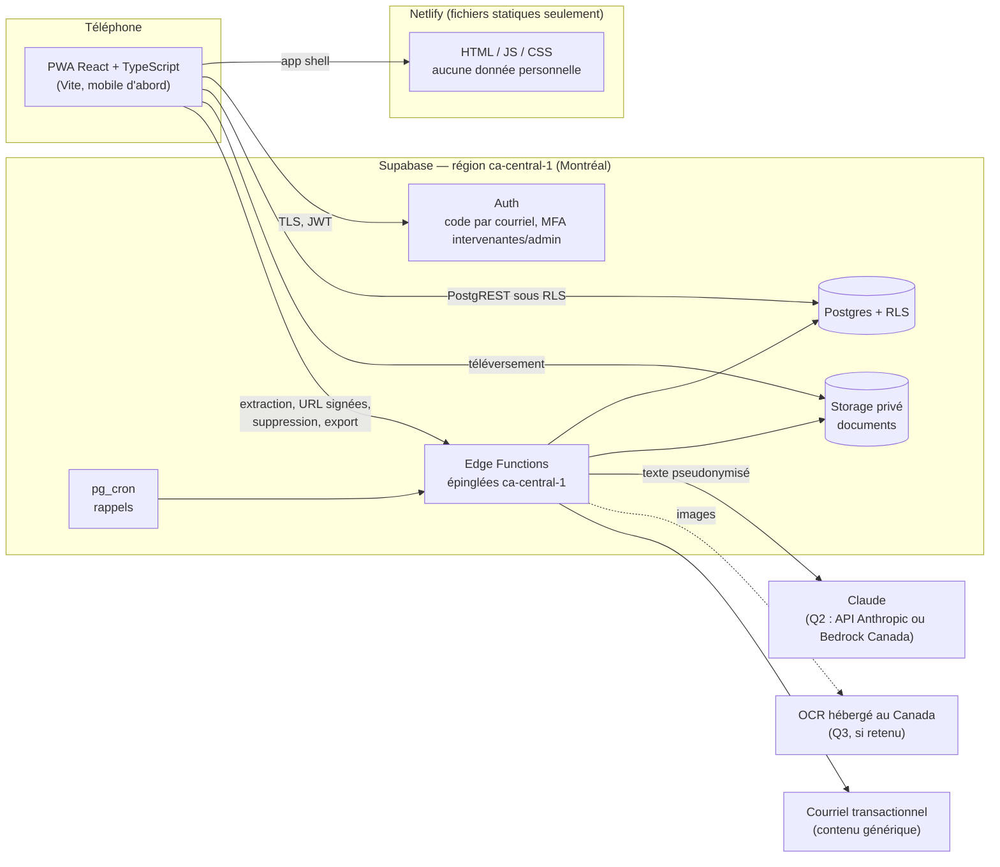
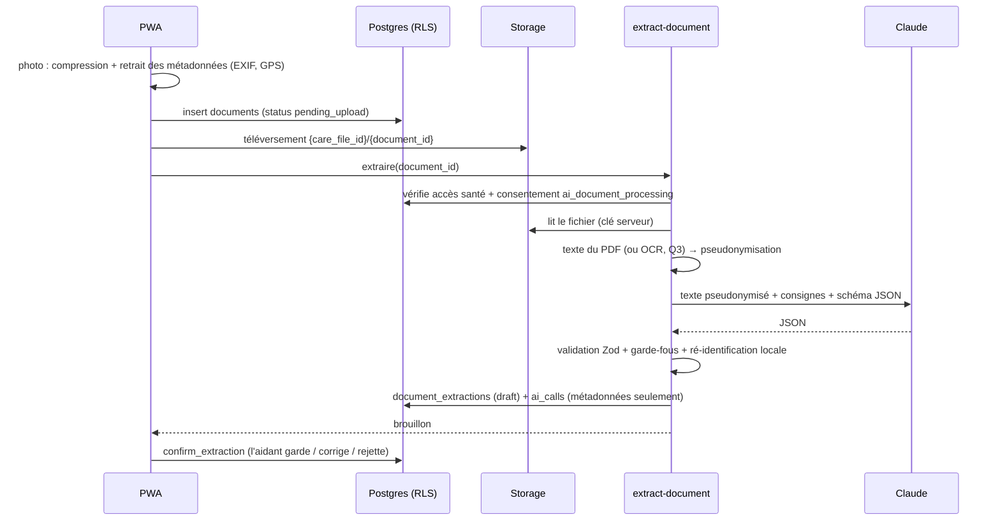

# Relais v0.1 — Architecture proposée

> Statut : **étapes 1 et 2 livrées** (socle, authentification, consentements ; dossier et membres). Les choix marqués _(Q1)_ à _(Q5)_
> suivent les hypothèses par défaut notées dans [`../PROGRESS.md`](../PROGRESS.md), en attendant les réponses.

## 1. Vue d'ensemble



- **Netlify ne sert que des fichiers statiques.** Aucune requête contenant des données du dossier n'y
  transite : le téléphone parle directement à Supabase, au Canada.
- **Tout le code serveur tourne dans des Edge Functions Supabase épinglées à `ca-central-1`**
  (option de région à l'appel, vérifiée en préproduction par l'en-tête de réponse). La clé de l'API
  Claude n'existe que là.
- **La base applique elle-même les permissions** (RLS) : même un client modifié ne peut pas lire au-delà
  de ce que son rôle autorise.

## 2. Pile technique

| Couche                    | Choix                                                                                   | Pourquoi                                                     |
| ------------------------- | --------------------------------------------------------------------------------------- | ------------------------------------------------------------ |
| Front                     | React 19 + TypeScript, Vite, `vite-plugin-pwa`, React Router, TanStack Query, Tailwind  | PWA légère, mobile d'abord, même base que Rempart            |
| Formulaires et validation | Zod (schémas partagés front / fonctions)                                                | Une seule définition des données                             |
| Base                      | Supabase Postgres 15+ avec RLS, région `ca-central-1`                                   | Hébergement au Canada, chiffrement au repos (AES-256) et TLS |
| Fichiers                  | Supabase Storage, bucket privé `documents`                                              | Même région ; aucune lecture directe (voir § 6)              |
| Serveur                   | Supabase Edge Functions (Deno), épinglées `ca-central-1`                                | Pas de serveur à gérer ; code IA isolé                       |
| IA                        | SDK officiel `@anthropic-ai/sdk`, modèle `ANTHROPIC_MODEL` (défaut `claude-sonnet-5-5`) | Sorties JSON validées (`messages.parse` + `zodOutputFormat`) |
| Planification             | `pg_cron` → fonction `send-reminders`                                                   | Rappels quotidiens                                           |
| Courriel                  | Fournisseur SMTP au Canada (ex. Amazon SES `ca-central-1`)                              | Courriels sans contenu de santé                              |
| Tests                     | Vitest, PostgreSQL 16 + shim Supabase (RLS), Playwright + axe, Lighthouse CI            | Mêmes outils que TrustCargo Pay dans ce dépôt                |

## 3. Organisation du code (proposée)

```
relais/
├── PROGRESS.md
├── docs/                      # architecture, plan, validations, schéma proposé
├── src/
│   ├── app/                   # routes, mise en page, garde de consentement
│   ├── features/              # onboarding, care-file, documents, timeline, benefits,
│   │                          # coordination, appointment-prep, wellbeing, support
│   ├── shared/                # code pur, sans dépendance d'exécution, testé par Vitest
│   │   ├── distress/          # détecteur de détresse (lexique + normalisation)
│   │   ├── rules-engine/      # moteur de règles du navigateur de droits
│   │   ├── pseudonymize/      # pseudonymisation (dictionnaire + motifs)
│   │   ├── schemas/           # schémas Zod (extraction, programmes, formulaires)
│   │   └── guards/            # garde-fous des sorties IA
│   ├── i18n/fr.ts             # tous les textes de l'interface (français simple)
│   └── lib/supabase.ts
├── supabase/
│   ├── migrations/            # une migration par étape
│   ├── functions/             # extract-document, get-document-url, explain-program,
│   │                          # draft-letter, invite-member, delete-care-file,
│   │                          # export-data, send-reminders, notify-support
│   ├── seed/                  # 2 familles fictives, 8 programmes « À VÉRIFIER », ressources
│   └── tests/                 # shim + rls_test.sql
└── tests/                     # unit, integration, e2e (Playwright + axe), lighthouse
```

_(Q1)_ Emplacement : dépôt dédié recommandé (application de santé : accès et secrets séparés) ; à défaut,
dossier `relais/` de ce dépôt, comme `dfn/` et `trustcargo-pay/`.

## 4. Règles non négociables → mécanismes

| Règle                               | Mécanisme                                                                                                                                                                                                                                                                                                  | Vérifié par                                                           |
| ----------------------------------- | ---------------------------------------------------------------------------------------------------------------------------------------------------------------------------------------------------------------------------------------------------------------------------------------------------------- | --------------------------------------------------------------------- |
| 1. Aucun conseil médical            | Prompts « résume ce qui est écrit, n'interprète rien » ; schéma de sortie sans champ d'avis ; garde-fou déterministe qui repère le langage de conseil (« vous devriez », « augmenter la dose », « normal », « inquiétant »…) et force « à vérifier » ; renvoi fixe vers le professionnel ou Info-Santé 811 | Tests unitaires des garde-fous + jeu de documents fictifs             |
| 2. Détresse                         | Détecteur déterministe exécuté **sur le téléphone** à chaque saisie libre ; écran d'urgence immédiat ; numéros lus dans `resources` (copie de secours générée à la compilation à partir de la même table, jamais d'un texte généré)                                                                        | Corpus de phrases types en test automatisé (doit toujours déclencher) |
| 3. Aucune invention                 | Le moteur de règles (sans IA) choisit les programmes ; l'IA ne reçoit que la fiche `programs` ; garde-fou : tout chiffre ou montant absent de la fiche fait rejeter la sortie ; champ `unknowns` → « Je ne sais pas »                                                                                      | Tests du moteur + tests des garde-fous                                |
| 4. Loi 25                           | 6 types de consentement distincts et révocables ; écritures de santé bloquées sans consentement actif (dans la base, pas seulement à l'écran) ; minimisation (année de naissance, jamais de NAM structuré) ; export et suppression ; journal des accès                                                     | Tests RLS + test de suppression                                       |
| 5. Canada, chiffrement, journaux    | Supabase `ca-central-1`, Edge Functions épinglées, Netlify statique ; TLS + chiffrement au repos ; journal applicatif par liste blanche de champs (identifiants, codes, durées) ; aucune donnée de santé dans les URL (filtres par POST/RPC)                                                               | Test du journaliseur + revue                                          |
| 6. Pseudonymisation avant Claude    | Voir § 5 ; _(Q2, Q3)_                                                                                                                                                                                                                                                                                      | Tests unitaires sur documents fictifs                                 |
| 7. Français simple, mobile, WCAG AA | Textes centralisés dans `fr.ts`, relus par la TS ; cibles tactiles 44 px, contraste AA, police 16 px min. ; axe dans chaque test e2e ; Lighthouse ≥ 90 mobile                                                                                                                                              | Playwright + axe + Lighthouse CI                                      |

## 5. Documents et extraction IA



**Rien n'entre au dossier sans confirmation** : l'extraction reste un brouillon jusqu'à
`confirm_extraction`, qui crée d'un seul coup les événements, médicaments tels qu'écrits, rendez-vous et
tâches retenus, chacun relié au document source.

**Pseudonymisation (avant tout appel IA)**

- Dictionnaire du dossier : prénom et nom de la personne aidée, noms des membres et des contacts,
  adresses connues → jetons `[PERSONNE_1]`, `[ADRESSE_1]`…
- Motifs : NAM (`AAAA 0000 0000`), code postal, téléphone, courriel, date de naissance précédée de
  « né(e) le » / « DDN », numéro civique + type de voie, noms précédés de « Dr », « Dre », « Mme », « M. ».
- La table de correspondance reste en mémoire dans la fonction, n'est jamais stockée ni envoyée ;
  les jetons de la réponse sont remplacés localement avant l'affichage.
- Compteurs (jamais les valeurs) enregistrés dans `ai_calls.pseudonymized_counts`.
- Risque résiduel à déclarer dans l'EFVP : un nom inconnu du dossier, sans titre, peut passer.

**Photos et PDF numérisés** _(Q3)_ : on ne peut pseudonymiser qu'un texte. Recommandation : OCR hébergé
au Canada, puis pseudonymisation du texte. Un document manuscrit ou flou (faible confiance OCR, ou
`legibility` ≠ `clear` dans la sortie) est marqué **« à vérifier »**.

**Sortie attendue (schéma Zod, version 1)** : `document_type`, `document_date`, `author` (fonction,
établissement), `plain_summary` (≤ 600 caractères, langage simple), `medications_as_written[]`
(nom, dose, fréquence et ligne d'origine, tels qu'écrits), `appointments[]`, `action_items[]`,
`timeline_events[]`, `legibility`, `needs_review`, `review_reasons[]`. Aucun champ d'interprétation.

**Appel au modèle**

- `client.messages.parse()` avec `output_config.format = zodOutputFormat(schéma)`, modèle lu dans
  `ANTHROPIC_MODEL` (défaut `claude-sonnet-5-5`), effort réglé bas et mesuré pour tenir la cible.
- Refus du modèle (`stop_reason: "refusal"`) : repli serveur `fallbacks: "default"` sur l'API Anthropic
  (sur Bedrock : intergiciel de repli du SDK) ; sinon le document passe en saisie manuelle.
- Cible **< 30 s pour un PDF de 3 pages** : texte extrait localement (quelques ko envoyés), un seul
  appel, délai d'expiration à 25 s ; mesuré par un test d'intégration sur un PDF fictif.

**Fournisseur** _(Q2)_ : l'API Anthropic directe ne propose que des zones « mondiale » ou « États-Unis »
(`inference_geo`) ; Claude via Amazon Bedrock pourrait rester au Canada si le modèle y est offert (à
vérifier). Le code isole le fournisseur derrière une interface `LlmClient` ; seul le texte
pseudonymisé sort de Supabase.

## 6. Accès, rôles et journal

**Matrice d'accès** (appliquée par `private.can_read` / `private.can_write`, voir [`schema.sql`](schema.sql)) :

| Zone de données                                                     | Propriétaire (aidant principal) | Accès complet | Coordination  | Lecture seule | Personne aidée |
| ------------------------------------------------------------------- | ------------------------------- | ------------- | ------------- | ------------- | -------------- |
| Profil (prénom, âge, milieu de vie)                                 | lire / écrire                   | lire / écrire | lire          | lire          | lire           |
| Coordination (tâches, rendez-vous, journal de bord, contacts)       | lire / écrire                   | lire / écrire | lire / écrire | lire          | lire           |
| Santé (documents, extractions, chronologie, médicaments, autonomie) | lire / écrire                   | lire / écrire | —             | lire          | lire           |
| Droits (questionnaire, programmes, pièces)                          | lire / écrire                   | lire / écrire | —             | lire          | lire           |
| Gestion (membres, invitations, journal des accès, suppression)      | oui                             | —             | —             | —             | —              |

- **Intervenante Relais** : membre du dossier seulement si l'aidant l'y invite, au niveau qu'il choisit ;
  rôle global `relais_worker` et MFA obligatoires, sinon aucun accès.
- **Admin** : gère `programs` et `resources` (MFA), voit les métriques sans contenu ; jamais membre
  d'un dossier par défaut.
- **Bilan de l'aidant** : visible par son auteur seulement.
- **Écritures** (hors gestion) : exigent le consentement actif de la personne aidée pour le dossier ;
  les écritures de santé exigent aussi le consentement `health_information` de l'auteur.

**Journal des accès (`access_log`)** : append-only, sans contenu. Écrit automatiquement par la base pour
les membres, invitations, consentements et documents ; écrit par les fonctions serveur pour chaque
téléchargement de document (URL signée de 60 s, seule voie de lecture d'un fichier) ; écrit par
l'interface pour l'ouverture du dossier, la consultation d'une extraction et l'impression d'une fiche.
L'aidant principal consulte le journal de son dossier. Complément possible : `pgaudit` côté base.

**Suppression d'un dossier** : la fonction `delete-care-file` vérifie que l'appelant est propriétaire,
efface les fichiers par l'API Storage, puis appelle `private.purge_care_file` qui supprime tout par
cascade et ne laisse au journal **que la trace de la suppression** (acteur, date, nombres d'éléments).
Les bilans de l'aidant (ses propres données) sont conservés. Les sauvegardes Supabase conservent les
données jusqu'à leur expiration : point à valider par le juriste.

**Droit d'accès et portabilité** : export JSON structuré. Les données propres à la personne passent par la
fonction SQL `export_my_data` (étape 1) ; l'export d'un dossier avec ses documents passera par la fonction
serveur `export-data` (étape 2), seule à pouvoir lire Storage.

**Suppression du compte** : fonction SQL `delete_my_account` (étape 1), qui efface le compte Auth et, par
cascade, le profil et les consentements ; le journal garde l'identifiant pseudonyme et la trace. À l'étape 2,
elle refusera tant que la personne est propriétaire d'un dossier (transfert ou suppression d'abord).

## 7. Navigateur de droits

1. Questionnaire court : âge (ou année de naissance déjà connue), milieu de vie, tranche de revenu,
   dépenses d'aide à domicile (oui / non), besoins d'adaptation du logement.
2. **Moteur de règles en TypeScript pur, sans IA** : compare les réponses aux `criteria` de chaque
   fiche, écrits dans un petit langage JSON :
   ```json
   {
     "all": [
       { "fact": "recipient_age", "op": ">=", "value": 70 },
       { "fact": "living_setting", "op": "in", "value": ["home", "rpa"] }
     ]
   }
   ```
   Résultat par programme : `likely`, `possible` (information manquante) ou `unlikely`, avec les
   raisons. Chaque carte affiche la source officielle, la date de vérification (ou « À VÉRIFIER ») et
   la mention « admissibilité à confirmer auprès de l'organisme ».
3. **Explication par l'IA** : à partir de la seule fiche `programs` (aucune donnée personnelle), mise en
   cache par version de fiche ; si la fiche ne contient pas l'information, la réponse dit qu'elle ne
   sait pas.
4. **Brouillon de lettre** : l'IA rédige avec des espaces réservés (`[NOM DE LA PERSONNE]`…) que le
   téléphone remplit localement ; aucun nom n'est envoyé.

## 8. Détresse

- Détecteur `shared/distress` : texte normalisé (minuscules, sans accents, espaces), lexique de motifs
  (idées suicidaires, crise, violence, danger immédiat), y compris expressions québécoises ; en cas de
  doute, il déclenche. Aucune IA dans la décision.
- Branché sur toutes les saisies libres : journal de bord, notes, commentaires du bilan, demande
  d'intervenante, questions de rendez-vous.
- Écran plein, immédiat, accessible au clavier et au lecteur d'écran : 911, 9-8-8 et autres ressources
  `emergency` / `crisis_line` lues dans `resources` (lisible même sans session) ; bouton « Parler à une
  intervenante » qui crée une demande `origin = distress_screen`. Le texte précise que Relais n'est pas
  un service d'urgence _(Q4)_.

## 9. Coordination, rendez-vous, charge de l'aidant

- Tâches (responsable, échéance), calendrier partagé des rendez-vous (qui accompagne), journal de bord,
  rappels quotidiens par courriel au contenu générique (« Vous avez 2 tâches cette semaine dans
  Relais »), sans détail de santé.
- **Préparer un rendez-vous** : page imprimable produite **sans IA** à partir du dossier (situation,
  changements récents de la chronologie, médicaments tels qu'écrits avec leur document source,
  questions saisies par la famille).
- **Bilan hebdomadaire** : 3 questions (fatigue, débordement, isolement) sur 1 à 5 ; au-delà du seuil
  (proposé : total ≥ 12 ou une réponse à 5, à valider par la TS), suggestions de répit tirées de
  `resources` et offre de parler à une intervenante. Pas un outil clinique.
- **Mesures du pilote** : temps gagné estimé et satisfaction (consentement `pilot_evaluation`),
  programmes repérés → demandés → décision (dates dans `care_file_programs`).

## 10. Tests et intégration continue

| Niveau                      | Outil                                                        | Exemples                                                                                   |
| --------------------------- | ------------------------------------------------------------ | ------------------------------------------------------------------------------------------ |
| Base                        | PostgreSQL 16 + shim Supabase, `rls_test.sql` auto-vérifiant | Chaque rôle × chaque table × lecture / écriture ; consentements ; suppression              |
| Unitaires                   | Vitest                                                       | Détecteur de détresse (corpus), moteur de règles, pseudonymisation, garde-fous IA, schémas |
| Intégration                 | Vitest + client IA simulé ; test réel optionnel avec clé     | Pipeline d'extraction, temps < 30 s sur PDF fictif de 3 pages                              |
| Bout en bout                | Playwright (Pixel 7) + axe, faux Supabase local              | Parcours par étape, aucune violation WCAG 2.2 AA, aucune violation de la CSP de production |
| Performance / accessibilité | Lighthouse (mobile), piloté par Playwright                   | Accessibilité ≥ 90 sur chaque page, y compris les pages connectées                         |

Le faux Supabase (`tests/e2e/fake-supabase.mjs`) simule Auth (code par courriel, TOTP) et traduit chaque
requête PostgREST de l'application en SQL, exécuté sur la vraie base migrée sous le rôle et l'identité de
l'appelant (`scripts/test-db.sh --serve`) : les parcours vérifient donc la vraie RLS. Il sert aussi aux
démonstrations locales sans compte Supabase. Une étape n'est livrée que si tout est vert en CI
(`.github/workflows/relais.yml`).
