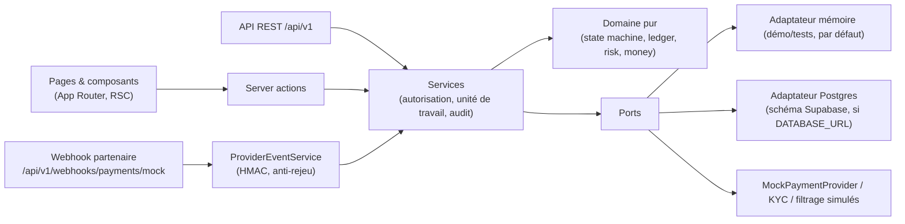
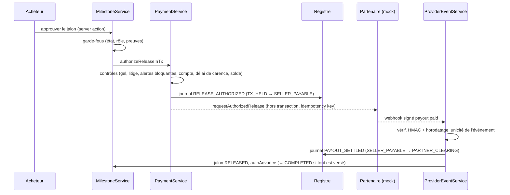

# Architecture

## Principes

1. **Le domaine est pur.** `src/domain` ne dépend ni de Next.js, ni de la base, ni du réseau. On y trouve la monnaie, le VIN, la machine à états, le registre, l'antifraude et les règles documentaires. Tout y est testable unitairement.
2. **Ports et adaptateurs.** Les services ne connaissent que des interfaces (`src/server/ports`) : `Db`/`UnitOfWork`, `PaymentProvider`, `IdentityVerificationProvider`, `ScreeningProvider`, `FileStorage`, `FileScanner`, `Clock`. Le choix des implémentations se fait **uniquement** dans `src/server/app.ts`.
3. **L'autorisation se fait côté serveur, dans les services.** Chaque opération reçoit un `Actor` résolu depuis la session signée. Les rôles sont relus en base à chaque requête. L'interface n'est jamais une barrière de sécurité : les drapeaux `can.*` des vues ne servent qu'à l'affichage.
4. **L'argent ne bouge que sur événement authentifié du partenaire.** Les transitions financières (`FUNDING_INITIATED`, `FUNDS_CONFIRMED`, `FUNDING_FAILED`) ne sont autorisées qu'à l'acteur `PROVIDER`. Les services n'utilisent cet acteur qu'après vérification HMAC d'un webhook.
5. **Moteur générique, modules spécialisés.** Le moteur de transaction, les jalons, les contrats, les litiges, le registre et les paiements sont agnostiques du secteur. Le spécifique « véhicule » se limite à quelques éléments : l'entité `Vehicle`, le contrôle VIN, les règles antifraude de la catégorie `VEHICLE`, les types de documents et les jalons par défaut. `TransactionType` prévoit déjà `GOODS_PURCHASE` et `SERVICE_MILESTONES`.

## Couches

### Unité de travail

`UnitOfWork.run(fn)` exécute `fn` de façon atomique. L'adaptateur mémoire sérialise les unités de travail et restaure un instantané en cas d'erreur. Il détecte aussi les appels imbriqués via `AsyncLocalStorage`, ce qui permet de rejoindre la transaction englobante sans risque entre requêtes concurrentes. L'adaptateur Postgres (`src/server/adapters/postgres/`, choisi par `createPersistence` quand `DATABASE_URL` est défini) ouvre une transaction SQL par unité de travail : `BEGIN`, `SET LOCAL ROLE service_role`, un verrou consultatif global (`pg_advisory_xact_lock`) qui reproduit la sérialisation de l'adaptateur mémoire entre processus, avec sa propre attente bornée (30 s, indépendante du `lock_timeout`), puis les délais `lock_timeout` / `statement_timeout` de l'unité de travail, et `COMMIT` (ou `ROLLBACK`). Un délai dépassé (`55P03`, `57014`) remonte comme erreur réessayable `UNAVAILABLE` (HTTP 503), jamais comme erreur interne. Les appels imbriqués rejoignent la transaction englobante ; l'unité de travail est rejouée en entier sur `40001`/`40P01`. Le verrou optimiste `transactions.version` et la chaîne d'audit sont aussi vérifiés par la base. Le passage TypeScript ↔ colonnes est déclaratif (`tables.ts` : une spécification par table, champ → colonne(s) + codec) et sans perte : chaque entité relue est identique à celle écrite. Seule règle commune aux deux adaptateurs (`src/server/text.ts`), imposée par Postgres : un demi-caractère UTF-16 isolé est stocké comme U+FFFD et U+0000 est refusé (`VALIDATION`) ; les services coupent les textes saisis sur des points de code. Les identifiants sont des UUIDv7 monotones (`uuid-v7.ts`), donc l'ordre `ORDER BY id` suit l'ordre de création, comme l'ordre d'insertion en mémoire.

**Aucune entrée/sortie externe dans une unité de travail.** Les appels au partenaire suivent un schéma de type « outbox » :

1. Une première unité de travail crée le versement `REQUESTED` et le journal d'autorisation.
2. Le partenaire est appelé hors transaction.
3. Une deuxième unité de travail enregistre `SUBMITTED`. En cas d'échec, elle enregistre l'erreur et le nombre de tentatives.

**Partenaire simulé.** `MockPaymentProvider` (SIMULATION uniquement, aucun fonds réel) garde ses propres enregistrements, comme le ferait un partenaire externe, derrière `SimulatedPartnerStore` (`src/server/adapters/mock/simulated-partner-store.ts`) : en mémoire par défaut, dans le schéma `trustcargo_sim` avec Postgres (`pg-simulated-partner-store.ts`, choisi par `createPersistence`). Le magasin Postgres a son propre petit pool de connexions et chaque écriture est une transaction SQL courte, validée avant l'émission du webhook signé : elle ne rejoint jamais l'unité de travail de l'appelant (une unité de travail annulée laisse les enregistrements du partenaire intacts). L'idempotence repose sur des clés uniques (`INSERT … ON CONFLICT DO NOTHING`), sûre entre instances. `persistence.close()` ferme aussi ce pool. Le compteur de panne simulée reste en mémoire du processus. Exception : pendant l'amorçage de démonstration, les écritures du partenaire simulé sont retenues puis publiées dans l'ordre une fois les scénarios réussis (`withStagedWrites`), pour qu'un amorçage annulé ne laisse rien chez lui.

### Flux d'un versement

## Décisions (ADR condensées)

| # | Décision | Raison | Conséquence |
| --- | --- | --- | --- |
| 1 | Application autonome dans `trustcargo-pay/` | Le dépôt contenait un starter Netlify sans lien avec le produit, qu'il ne fallait pas casser | Le `tsconfig` racine exclut `trustcargo-pay` |
| 2 | Next.js 16 (App Router), React 19, TS strict avec `noUncheckedIndexedAccess` | Version stable actuelle ; la sûreté de typage est critique pour un produit financier | `proxy.ts` remplace `middleware.ts` |
| 3 | Montants en `bigint` d'unités mineures, répartition par la méthode du plus fort reste | Déterminisme : la somme des jalons est toujours exacte | Les DTO transportent les montants en chaîne |
| 4 | Machine à états déclarative (`TRANSITIONS`) | Chaque transition expose ses états source, ses acteurs autorisés, ses gardes, son action d'audit et sa politique de reprise | Les gardes en échec sont renvoyés à l'interface (messages explicables) |
| 5 | Registre en partie double, en ajout seul, corrections par contrepassation | Intégrité comptable, idempotence par clé | Le solde `TX_HELD` sert de contrôle avant tout versement |
| 6 | Règles antifraude explicables, sans score numérique | Exigence produit ; pas de modèle validé statistiquement | Priorité, motifs, action recommandée, revue humaine |
| 7 | Adaptateur mémoire par défaut (démo, tests) ; adaptateur Postgres sur le schéma Supabase quand `DATABASE_URL` est défini | Démo exécutable sans service externe ; même suite d'intégration sur les deux adaptateurs | Verrou consultatif global : une unité de travail à la fois par base (limite assumée du MVP, voir mise en production) |
| 8 | MFA TOTP (RFC 6238) en démo, Supabase Auth AAL2 en cible | Démontrer le step-up sans dépendance | Validité configurable : 12 h pour le back-office, 15 min pour les actions sensibles |
| 9 | Chaîne d'audit par empreintes SHA-256 | Détection d'altération et de suppression | Genèse = 64 zéros, identique côté SQL |
| 10 | Invitations : jeton aléatoire de 256 bits, stocké haché, à usage unique, lié au courriel | Éviter la prise de contrôle par lien partagé | Les invitations sont aussi visibles dans le tableau de bord du compte invité |
| 11 | 404 au lieu de 403 sur les ressources inaccessibles | Ne pas révéler l'existence d'une transaction | Les refus d'accès aux documents sont journalisés à part (`DENIED`) |
| 12 | `platform_admin` n'a pas accès aux transactions | Moindre privilège : la configuration est séparée des opérations | Il faut un rôle opérationnel distinct pour lire un dossier |

## Extension à d'autres verticales

Pour ajouter par exemple « marchandises B2B » :

1. Ajouter l'entité spécifique (`GoodsLot`) et son schéma Zod.
2. Ajouter les types de documents et les jalons par défaut.
3. Ajouter les règles antifraude de la nouvelle catégorie (`RULES` est extensible).
4. Ouvrir l'assistant au nouveau type.

La machine à états, les contrats, les jalons, les paiements, le registre et les litiges sont réutilisés tels quels.

Pour ajouter un corridor, il suffit de créer une entrée `corridors` : devises, seuil de revue renforcée, ports attendus, documents requis.
