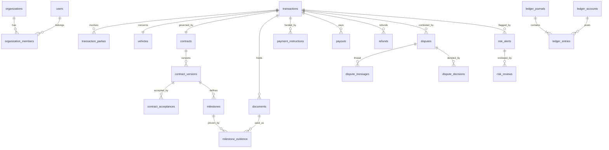

# Modèle de données

Sources :

- Types TypeScript : `src/domain/model.ts`
- Schéma SQL : `supabase/migrations/` (40 tables, testées sur PostgreSQL 16)

## Conventions

- **Montants** : `amount_minor bigint` + `currency` (domaine `currency_code` : CAD, USD, EUR, XOF). Jamais de flottant. XOF a 0 décimale, les autres 2.
- **Identifiants** : UUID. Références lisibles `TC-AAAA-NNNNN` (unique).
- **Horodatages** : `timestamptz`, ISO 8601 UTC côté TypeScript.
- **Verrou optimiste** : `transactions.version`.
- **Ajout seul (append-only)** : `ledger_journals`, `ledger_entries`, `audit_events`, `contract_acceptances`, `document_verifications`, `document_access_logs`, `risk_reviews`, `dispute_messages`, `dispute_decisions`, `reconciliations`, `session_events`. `provider_events` n'est ni supprimable ni modifiable, sauf pour son statut de traitement.

## Domaines fonctionnels

| Domaine | Tables |
| --- | --- |
| Identité & organisations | `users`, `user_platform_roles`, `organizations`, `organization_members`, `identity_verifications`, `beneficial_owners`, `screening_results`, `session_events` |
| Coordonnées de versement | `payment_accounts` (identifiant masqué + jeton du coffre partenaire uniquement) |
| Transactions | `transactions`, `transaction_parties`, `vehicles`, `corridors` |
| Contrat | `contracts`, `contract_versions` (conditions JSON + empreinte SHA-256), `contract_acceptances` (liées à l'empreinte) |
| Jalons | `milestones` (par version de contrat), `milestone_evidence` |
| Documents | `documents` (versionnés par `logical_id`, empreinte, statut d'analyse, rôles autorisés), `document_verifications`, `document_access_logs` |
| Risque & conformité | `risk_alerts` (empreinte unique, motifs JSON), `risk_reviews`, `compliance_holds` |
| Litiges | `disputes`, `dispute_messages`, `dispute_decisions` |
| Paiements | `payment_instructions`, `payouts`, `refunds`, `provider_events` (unique `(provider, external_event_id)`), `provider_connections` (référence du secret uniquement) |
| Registre | `ledger_accounts`, `ledger_journals` (clé d'idempotence unique), `ledger_entries`, `reconciliations`, `reconciliation_items` |
| Transverse | `audit_events` (séquence + chaîne d'empreintes), `notifications`, `security_settings` |

## Relations clés

## Plan comptable du registre

Le registre retrace les mouvements **signalés par le partenaire**. Ce n'est **pas** une preuve que TrustCargo détient des fonds.

| Compte | Type | Sens |
| --- | --- | --- |
| `PARTNER_CLEARING:{provider}:{devise}` | Actif | Fonds que le partenaire déclare détenir pour les transactions |
| `TX_HELD:{transaction}:{devise}` | Passif | Montant d'une transaction encore à attribuer |
| `SELLER_PAYABLE:{transaction}:{devise}` | Passif | Versement autorisé, en attente de confirmation |
| `BUYER_REFUNDABLE:{transaction}:{devise}` | Passif | Remboursement autorisé, en attente de confirmation |

| Événement | Écriture |
| --- | --- |
| `funds.confirmed` (webhook signé) | Dr PARTNER_CLEARING / Cr TX_HELD |
| Approbation d'un jalon ou décision de litige | Dr TX_HELD / Cr SELLER_PAYABLE |
| `payout.paid` | Dr SELLER_PAYABLE / Cr PARTNER_CLEARING |
| `payout.failed` | contrepassation de l'autorisation |
| Décision de remboursement | Dr TX_HELD / Cr BUYER_REFUNDABLE |
| `refund.completed` | Dr BUYER_REFUNDABLE / Cr PARTNER_CLEARING |

Contrôles en base :

- équilibre débit = crédit par journal et par devise, vérifié au COMMIT par une contrainte différée ;
- devise de l'écriture = devise du compte ;
- tables en ajout seul : toute correction passe par contrepassation ;
- `post_ledger_journal()` idempotente, réservée à `service_role`.

## Isolation (RLS)

Toutes les tables ont le RLS activé et `anon` n'a aucun droit. L'accès en lecture est accordé ainsi :

- **Parties d'une transaction** : utilisateur ou membre de l'organisation partie, avec statut `JOINED`. Ils voient la transaction, le contrat, les jalons et les litiges.
- **Inspecteurs et transitaires** : pas d'accès aux paiements ni aux litiges.
- **Documents** : visibles selon `visible_to_roles`. Les pièces `IDENTITY` ne sont visibles que par leur propriétaire et la conformité.
- **Personnel** : selon le rôle, avec le minimum nécessaire (voir `supabase/README.md`).

Toutes les écritures métier passent par le serveur (`service_role`), qui applique la machine à états et écrit l'audit dans la même transaction.
