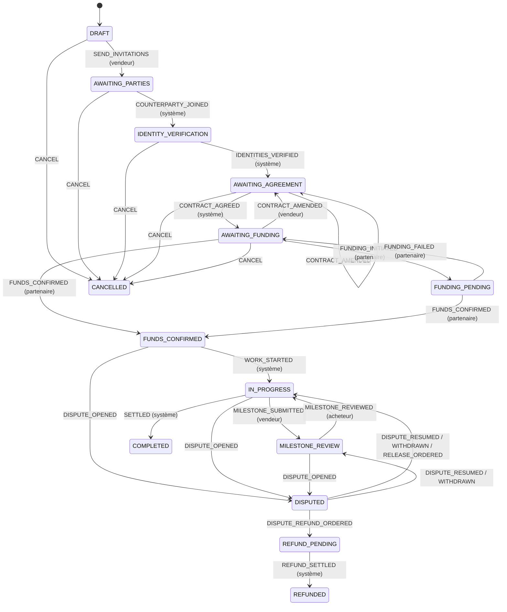

# Moteur de transaction et workflows

Source de vérité : `src/domain/transaction/state-machine.ts`. Chaque transition déclare :

- ses **états source** et son **état cible** ;
- les **acteurs autorisés** : `SELLER`, `BUYER`, `SYSTEM`, `PROVIDER`, `DISPUTE_MANAGER`, `COMPLIANCE` ;
- ses **gardes**, c'est-à-dire les conditions d'entrée, chacune avec un code explicable ;
- l'**action d'audit** émise, qui sert aussi d'événement métier ;
- sa **politique de reprise** :
  - `RETRY_IDEMPOTENT` : rejouable automatiquement ;
  - `MANUAL_REVIEW` : file opérationnelle ;
  - `USER_RETRY` : l'utilisateur corrige puis réessaie ;
- un indicateur `financial`.

Le service `Workflow` construit le contexte à partir des faits persistés, évalue la transition, applique la mise à jour avec verrou optimiste et écrit l'événement d'audit chaîné dans la même unité de travail. `autoAdvance` applique toutes les transitions automatiques dont les gardes passent ; cette opération est idempotente.

## États principaux

## Table des transitions

| Transition | Source → cible | Acteurs | Gardes | Reprise |
| --- | --- | --- | --- | --- |
| SEND_INVITATIONS | DRAFT → AWAITING_PARTIES | Vendeur | contrat présent, jalons = 100 %, VIN structurellement valide, corridor ouvert | USER_RETRY |
| COUNTERPARTY_JOINED | AWAITING_PARTIES → IDENTITY_VERIFICATION | Système | acheteur a rejoint | RETRY_IDEMPOTENT |
| IDENTITIES_VERIFIED | IDENTITY_VERIFICATION → AWAITING_AGREEMENT | Système | KYC vendeur et acheteur vérifiés | RETRY_IDEMPOTENT |
| CONTRACT_AGREED | AWAITING_AGREEMENT → AWAITING_FUNDING | Système | KYC + acceptation de **la version courante** par les deux parties (empreinte identique) | RETRY_IDEMPOTENT |
| CONTRACT_AMENDED | AWAITING_AGREEMENT / AWAITING_FUNDING → AWAITING_AGREEMENT | Vendeur | aucun financement commencé, jalons = 100 % | USER_RETRY |
| FUNDING_INITIATED | AWAITING_FUNDING → FUNDING_PENDING | **Partenaire** | instruction active, aucun gel | RETRY_IDEMPOTENT |
| FUNDS_CONFIRMED | AWAITING_FUNDING / FUNDING_PENDING → FUNDS_CONFIRMED | **Partenaire** | instruction active, **montant et devise exactement égaux** | MANUAL_REVIEW |
| FUNDING_FAILED | FUNDING_PENDING → AWAITING_FUNDING | **Partenaire** | — | RETRY_IDEMPOTENT |
| WORK_STARTED | FUNDS_CONFIRMED → IN_PROGRESS | Système | solde `TX_HELD` = total, jalon actif | RETRY_IDEMPOTENT |
| MILESTONE_SUBMITTED | IN_PROGRESS → MILESTONE_REVIEW | Vendeur | jalon actif, **toutes les preuves exigées**, aucun gel | USER_RETRY |
| MILESTONE_REVIEWED | MILESTONE_REVIEW → IN_PROGRESS | Acheteur | jalon soumis | USER_RETRY |
| SETTLED | IN_PROGRESS → COMPLETED | Système | tous les jalons versés, aucune opération en attente | RETRY_IDEMPOTENT |
| DISPUTE_OPENED | FUNDS_CONFIRMED / IN_PROGRESS / MILESTONE_REVIEW → DISPUTED | Vendeur, acheteur | aucun litige ouvert | USER_RETRY |
| DISPUTE_WITHDRAWN | DISPUTED → état antérieur | Partie à l'origine du litige | état antérieur connu | USER_RETRY |
| DISPUTE_RESUMED | DISPUTED → état antérieur | Gestionnaire des litiges | **MFA récente** | USER_RETRY |
| DISPUTE_RELEASE_ORDERED | DISPUTED → IN_PROGRESS | Gestionnaire des litiges | MFA, aucun gel | MANUAL_REVIEW |
| DISPUTE_REFUND_ORDERED | DISPUTED → REFUND_PENDING | Gestionnaire des litiges | MFA, aucun gel | MANUAL_REVIEW |
| REFUND_SETTLED | REFUND_PENDING → REFUNDED | Système | aucune opération en attente | RETRY_IDEMPOTENT |
| CANCEL | états avant financement → CANCELLED | Vendeur, acheteur, conformité | aucun financement commencé | USER_RETRY |

Les mêmes transitions sont aussi contrôlées en base, par un trigger dans `supabase/migrations`, en défense en profondeur.

## Cycles de vie séparés : versements et remboursements

| Versement (`payouts`) | Remboursement (`refunds`) |
| --- | --- |
| `REQUESTED` → `SUBMITTED` → (`PROCESSING`) → `PAID` | `REQUESTED` → `SUBMITTED` → (`PROCESSING`) → `REFUNDED` |
| `FAILED` → `CANCELLED` (remplacé par une nouvelle tentative) | idem |

- `REQUESTED` : instruction autorisée et journal d'autorisation passé ; pas encore transmise au partenaire. En cas de panne du partenaire, le statut reste `REQUESTED` avec `failureReason` et `attempts`, puis la transmission est relancée.
- `PAID` / `REFUNDED` : **uniquement** sur webhook signé du partenaire.
- Un `FAILED` signalé par le partenaire déclenche la contrepassation du journal d'autorisation. Les fonds reviennent dans `TX_HELD`. La relance crée une **nouvelle** instruction (nouvelle clé d'idempotence).

## Événements du partenaire tardifs, rejoués ou dans le désordre

Un événement signé n'est appliqué que s'il correspond encore à l'état enregistré. Sinon, il est audité puis ignoré (statut `IGNORED`) : l'argent n'est jamais déplacé deux fois.

- `payment.initiated`, `payment.pending` et `payment.failed` n'agissent que sur une instruction encore en attente de fonds (`CREATED` ou `PENDING`). Un échec reçu après la confirmation des fonds (renvoi tardif, événement resté `RECEIVED` puis retraité) ne remet jamais une instruction `FUNDED` en échec et n'avertit pas les parties. La progression d'une instruction `FAILED` ne fait pas repasser la transaction en `FUNDING_PENDING`. Action d'audit : `provider_event.stale_instruction_ignored`.
- La progression d'une instruction remplacée par un amendement (autre version de contrat ou autre montant) ne fait jamais avancer la transaction, qui reste modifiable. L'échec d'une telle instruction la clôt, sans avertir les parties.
- Une seule instruction payable à la fois : tant qu'une instruction de la version en vigueur est `CREATED` ou `PENDING`, une nouvelle demande la renvoie au lieu d'en émettre une seconde.
- Un versement ou un remboursement déjà réglé ignore la répétition du même résultat (doublon). Un résultat contradictoire (`payout.paid` après un échec contrepassé, `payout.failed` après paiement, de même pour les remboursements) n'est jamais appliqué : action d'audit `provider_event.contradicts_settlement` et notification des opérations financières pour revue. La réconciliation fait aussi apparaître l'écart.

## Contrôles avant versement (`releaseBlockers`)

Aucune instruction de versement n'est créée si l'une de ces conditions est vraie :

- mesure de conformité active (gel) ;
- litige ouvert, sauf exécution d'une décision de litige ;
- alerte de risque bloquante ouverte ou en revue ;
- compte de versement absent, non vérifié ou dans une autre devise ;
- délai de carence non écoulé après un changement de compte (72 h par défaut) ;
- solde `TX_HELD` insuffisant au registre.

Le jalon reste alors `APPROVED`. Le versement est relancé automatiquement après une revue qui lève l'alerte ou une levée de gel. Il peut aussi être relancé manuellement par les opérations financières ou la conformité.

## Contrat versionné

- Chaque version contient les conditions complètes et une empreinte SHA-256 de leur JSON canonique, calculée sur les conditions telles qu'elles sont stockées (règle de texte commune, voir le modèle de données) : l'empreinte affichée correspond toujours au texte affiché, et une modification identique au contenu stocké est refusée (aucun changement).
- Une acceptation porte sur `(version, empreinte)`. Accepter une version obsolète ou altérée est refusé : erreur `CONFLICT`.
- Une modification crée la version n+1 et remplace l'instruction de paiement non financée. Les jalons sont recalculés et **toutes les parties doivent accepter à nouveau**. La vue affiche les champs modifiés.

## Litiges

1. **Ouverture** par une partie (motif, description d'au moins 20 caractères, résultat souhaité, jalon éventuel). Elle gèle les versements.
2. **Notification** de l'autre partie et des gestionnaires. Le délai de réponse est fixé par le contrat (`reviewDays`).
3. **Réponse contradictoire** : le premier message de l'autre partie fait passer le litige à `UNDER_REVIEW`.
4. **Prise en charge et analyse** par un gestionnaire des litiges, qui ne peut pas être partie à la transaction.
5. **Décision motivée** : issue, clause contractuelle, montants. La décision exige une MFA récente.
6. **Instructions au partenaire.** Rien n'est payé ni remboursé avant sa confirmation signée.
7. **Résolution** automatique quand toutes les instructions de la décision sont réglées, puis **archivage**.

Les obligations réglementaires (sanctions, ordonnances, gels) passent par les **mesures de conformité** (`compliance_holds`), indépendantes des litiges. Elles bloquent tout mouvement, même après une décision commerciale. Leur levée exige un second analyste (principe des quatre yeux).

## Antifraude

Le moteur se trouve dans `src/domain/risk/engine.ts`. Il compte 20 règles réparties en trois catégories :

- **utilisateur** : KYC, pièce expirée, divergence de nom, titulaire du compte, changement de bénéficiaire, connexion inhabituelle, comptes liés ;
- **transaction** : montant inhabituel, vélocité, modifications successives du contrat, coordonnées modifiées en cours, filtrage, facture incohérente ;
- **véhicule** : VIN mal formé, VIN divergent selon les documents, vendeur différent du titulaire, documents manquants, valeur déclarée, preuve d'exportation, document d'expédition.

À cela s'ajoute l'alerte `FUNDING_AMOUNT_MISMATCH`, levée par le traitement des webhooks : montant signalé différent de l'instruction, ou instruction qui n'est plus celle de la version de contrat et du montant en vigueur (amendement). `FUNDS_CONFIRMED` n'est alors jamais appliqué ; en base, `transactions_before_update` exige une instruction `FUNDED` du montant exact de la transaction.

Chaque alerte comporte :

- des **motifs** paramétrés (traduits FR/EN) ;
- une **priorité** (faible à critique) ;
- une **action recommandée** ;
- un indicateur « bloque les mouvements de fonds » ;
- un historique de revues humaines.

Les alertes sont dédupliquées par empreinte. Celles dont la condition a disparu, comme des documents manquants désormais fournis, sont clôturées automatiquement lorsque la règle le permet.

**Aucun score numérique n'est produit.** Un contrôle VIN local ne certifie jamais l'absence de vol ou de sûreté. Ces vérifications relèvent de fournisseurs habilités, à intégrer derrière un port dédié.
